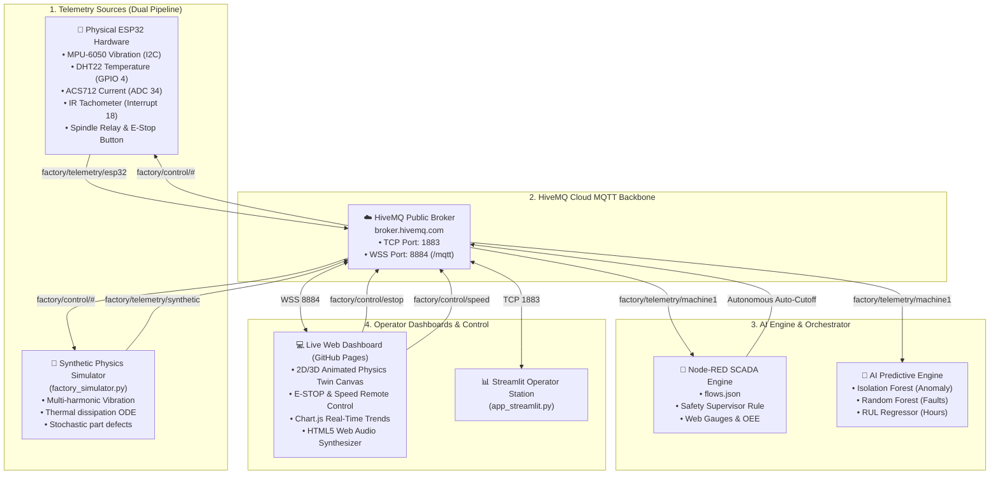

# 🏭 AI-Driven Digital Twin for Smart Factory Operations (Dual-Pipeline IoT)

An industrial-grade, cloud-connected **Cyber-Physical Digital Twin** designed for predictive maintenance, real-time telemetry monitoring, and autonomous supervisory control of advanced manufacturing assets (CNC Milling Spindles, Industrial Conveyors, and Automated Robotic Workstations).

Featuring a **dual-pipeline data architecture**, the system seamlessly ingests **synthetic multi-physics telemetry** or **real-world ESP32 sensor telemetry** via **HiveMQ MQTT**, orchestrated by **Node-RED**, analyzed by **Machine Learning Anomaly Detectors**, and remotely operated through a **high-tech interactive Web Control Dashboard**.

---

## 🌐 Live Interactive Web Dashboard & Direct Control Link

> **🚀 Public Control Deck**: [https://gsparsh580-coder.github.io/smart-factory-digital-twin/](https://gsparsh580-coder.github.io/smart-factory-digital-twin/)  
> *(Connects directly via secure WebSockets `wss://broker.hivemq.com:8884/mqtt` from any PC, tablet, or smartphone globally without installing any local software!)*

---

## 🌟 Key Highlights

- **Dual-Source Telemetry Pipeline**:
  - 🧪 **Synthetic Physics Simulator**: High-fidelity numerical simulation generating stochastic multi-physics telemetry (vibration harmonics, thermal dissipation, motor current, acoustics, and defect probability).
  - 🔌 **Physical ESP32 Edge Gateway**: Microcontroller reading real sensors (MPU-6050 vibration IMU, DHT22/DS18B20 temperature, ACS712 motor current, IR tachometer) with physical E-STOP button, relay spindle cutoff, and tri-color status LEDs.
- **AI-Powered Predictive Maintenance (PdM)**:
  - **Unsupervised Anomaly Detection**: Isolation Forest calculating real-time machine stress and anomaly scores (0.0 to 1.0).
  - **Remaining Useful Life (RUL) Regressor**: Predicts remaining operating hours before maintenance failure.
  - **Root-Cause Fault Classifier**: Automatically classifies faults into *Bearing Degradation*, *Thermal Overload*, *Mechanical Unbalance*, or *Motor Stall*.
- **Autonomous Hardware Safety Interlocks**:
  - Edge-level fail-safe: ESP32 automatically cuts relay power if temperature exceeds **85°C** or vibration exceeds **16 mm/s²**, without waiting for cloud/dashboard intervention.
  - Node-RED supervisor: Evaluates high-frequency streams and automatically publishes MQTT emergency stop (`factory/control/estop`).
- **Bidirectional Remote Control**:
  - 🛑 **EMERGENCY STOP (E-STOP)** button with acoustic alarm sirens.
  - 🟢 **SYSTEM RESUME & RESET**.
  - ⚡ **Target Spindle Speed Slider** (0 to 3000 RPM).
  - 🧪 **Live Anomaly Injection Matrix** to test the digital twin under simulated mechanical stress.
- **Production OEE Intelligence**:
  - Real-time **Overall Equipment Effectiveness** breakdown (Availability, Performance, Quality).
  - Part counters, cycle time analysis, and automated defect sorting animations.

---

## 🏗️ System Architecture



---

## 📂 Repository Directory Layout

```
smart_factory_digital_twin/
├── index.html                     # Responsive Web Digital Twin Dashboard (GitHub Pages Ready)
├── css/
│   └── styles.css                 # Custom industrial cyber styling, animations, glow effects
├── js/
│   └── app.js                     # MQTT.js WebSocket client, Canvas 2D/3D renderer, Web Audio API
├── simulator/
│   └── factory_simulator.py       # Multi-physics synthetic industrial telemetry generator
├── esp32_firmware/
│   ├── smart_factory_esp32.ino    # ESP32 C++ firmware sketch (WiFi + PubSubClient + MPU6050)
│   └── WIRING_AND_CIRCUITS.md     # Complete breadboard circuit schematic and pinout documentation
├── ai_engine/
│   └── predictive_maintenance_ai.py # Isolation Forest, RUL Regressor & Fault Classifier
├── node_red/
│   ├── flows.json                 # Production Node-RED SCADA flows with dashboard gauges
│   └── README.md                  # Node-RED setup and import instructions
├── .github/workflows/
│   └── deploy.yml                 # Automated GitHub Actions deployment to GitHub Pages
├── app_streamlit.py               # Optional Streamlit Python operator dashboard
├── docker-compose.yml             # 1-Click Docker deployment for Node-RED
├── requirements.txt               # Python package dependencies
├── setup_git_and_push.ps1         # Automated PowerShell script to commit & push to GitHub
├── run_simulator.bat              # 1-Click Windows batch script to launch simulator
├── run_ai_engine.bat              # 1-Click Windows batch script to launch AI engine
├── run_dashboard.bat              # 1-Click Windows batch script to serve dashboard locally
└── README.md                      # Comprehensive project documentation
```

---

## 📡 MQTT Topic Hierarchy (HiveMQ)

| Topic | Direction | Type | Description |
| :--- | :--- | :--- | :--- |
| `factory/telemetry/machine1` | Broker ➔ Dashboard | Inbound | Unified machine telemetry stream (1 Hz) |
| `factory/telemetry/synthetic` | Simulator ➔ Broker | Inbound | Raw synthetic physics stream |
| `factory/telemetry/esp32` | ESP32 ➔ Broker | Inbound | Raw physical edge hardware stream |
| `factory/telemetry/alerts` | Asset ➔ Broker | Inbound | Critical fault & safety trip notifications |
| `factory/analytics/health` | AI Engine ➔ Broker | Inbound | Real-time Health Index, RUL & Diagnosis |
| `factory/control/estop` | Control ➔ Asset | Outbound | Emergency Stop trigger (spindle cutoff) |
| `factory/control/reset` | Control ➔ Asset | Outbound | Clears E-Stop and resumes operations |
| `factory/control/speed` | Control ➔ Asset | Outbound | Adjusts target RPM setpoint (e.g. `{"targetRpm": 1800}`) |
| `factory/control/mode` | Control ➔ Asset | Outbound | Switches mode (`AUTO`, `MANUAL`, `MAINTENANCE`) |
| `factory/control/anomaly_inject` | Control ➔ Simulator | Outbound | Injects fault (`BEARING_WEAR`, `THERMAL_RUNAWAY`, `MOTOR_STALL`) |
| `factory/control/source_select` | Control ➔ Broker | Outbound | Toggles active source between `synthetic` and `esp32` |

---

## 🚀 Quick Start Guide

### Step 1: Clone or Navigate to the Project
```bash
cd smart_factory_digital_twin
```

### Step 2: Install Python Dependencies
```bash
pip install -r requirements.txt
```

### Step 3: Run the Synthetic Telemetry Simulator
```bash
python simulator/factory_simulator.py
```
*(Or simply double-click `run_simulator.bat` on Windows!)*  
The simulator immediately connects to HiveMQ and broadcasts real-time telemetry at 1 Hz.

### Step 4: Open the Web Dashboard
- **Instant Browser Access**: Simply double-click `index.html` or run `run_dashboard.bat`.
- Watch the 2D/3D animated spindle rotate, conveyor belt transport parts, and live telemetry stream over HiveMQ!

---

## 🔌 Hardware Setup with ESP32

To connect real physical sensors:

1. Follow the wiring instructions in [`esp32_firmware/WIRING_AND_CIRCUITS.md`](file:///c:/Users/sparsh/Documents/antigravity/wise-bardeen/smart_factory_digital_twin/esp32_firmware/WIRING_AND_CIRCUITS.md).
2. Open [`esp32_firmware/smart_factory_esp32.ino`](file:///c:/Users/sparsh/Documents/antigravity/wise-bardeen/smart_factory_digital_twin/esp32_firmware/smart_factory_esp32.ino) in Arduino IDE.
3. Configure your local WiFi network:
   ```cpp
   const char* WIFI_SSID     = "Your_WiFi_Name";
   const char* WIFI_PASSWORD = "Your_WiFi_Password";
   ```
4. Flash to the ESP32. As soon as it powers on, it connects to HiveMQ and publishes to `factory/telemetry/esp32`.
5. On the Web Dashboard, select **"ESP32 Hardware"** in the Data Source dropdown to switch from synthetic to physical hardware telemetry!

---

## 🔄 Node-RED Flow Setup

1. Start Node-RED using Docker:
   ```bash
   docker compose up -d
   ```
2. Open the Node-RED editor at [http://localhost:1880](http://localhost:1880).
3. Click **Menu (☰)** ➔ **Import** ➔ select `node_red/flows.json` ➔ click **Deploy**.
4. Open the Node-RED Dashboard at [http://localhost:1880/ui](http://localhost:1880/ui).

---

## 📤 Pushing to GitHub & Deploying GitHub Pages

To create your GitHub repository, push your code, and enable the live public dashboard:

### Automated Setup (PowerShell)
Run the included deployment script:
```powershell
.\setup_git_and_push.ps1
```

### Manual Setup (Step-by-Step)
1. Create a new repository on GitHub:
   - Visit [https://github.com/new](https://github.com/new)
   - Repository Name: `smart-factory-digital-twin`
   - Visibility: **Public**
   - Leave "Initialize with README" **unchecked**
2. In your terminal inside `smart_factory_digital_twin`:
   ```bash
   git init
   git add .
   git commit -m "feat: AI-Driven Digital Twin for Smart Factory Operations"
   git branch -M main
   git remote add origin https://github.com/gsparsh580-coder/smart-factory-digital-twin.git
   git push -u origin main
   ```
3. **Enable GitHub Pages**:
   - Go to your repository **Settings** ➔ **Pages** (in the left sidebar).
   - Under **Build and deployment** ➔ **Source**: Select **GitHub Actions** (our included `.github/workflows/deploy.yml` will automatically build and deploy the dashboard in under 60 seconds!).
   - Alternatively, select **Deploy from a branch** ➔ select branch `main` and folder `/ (root)` ➔ click **Save**.
4. **Access Your Live Dashboard**:
   - URL: **`https://gsparsh580-coder.github.io/smart-factory-digital-twin/`**
   - You can now open this link on your mobile phone or any computer in the world to remotely control and monitor your smart factory digital twin!

---

## 🛡️ License
This project is open-source and licensed under the MIT License.
